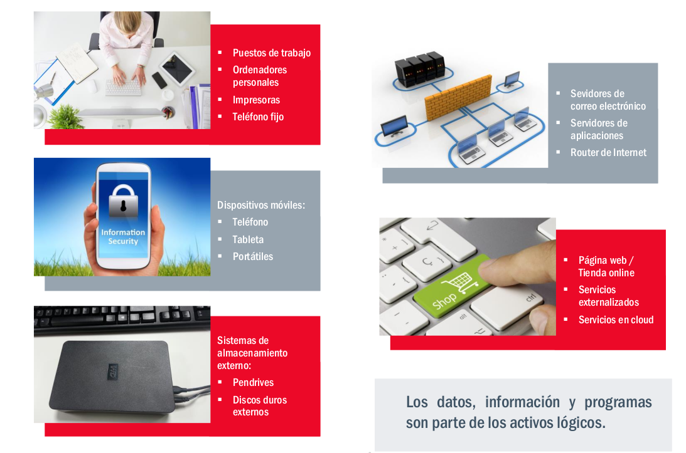
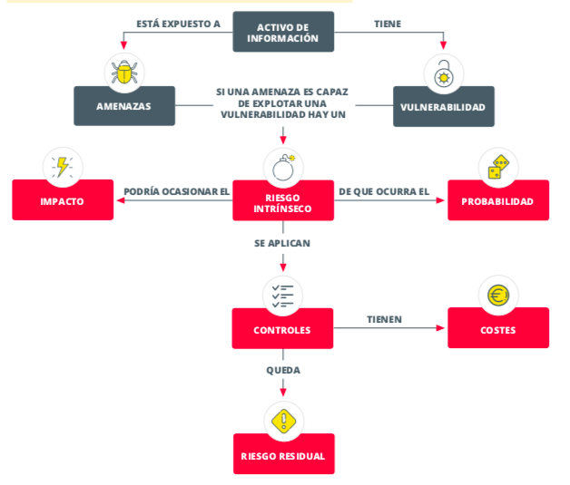

# 1.a.02 - Análisis de riesgos

**Ciclo de Especialización de FP en Ciberseguridad en Entornos de las Tecnologías de la Información · Unidad 1**

## Finalidad de la actividad

La empresa del caso quiere mejorar su seguridad después de sufrir una experiencia desagradable con malware. Antes de preparar su Plan Director de Seguridad (PDS), el equipo realizará un análisis sencillo de los riesgos que pueden afectar a la información, los sistemas y la actividad de la organización.

El análisis debe ayudar a responder tres preguntas:

1. ¿Qué información, servicios y recursos son más importantes para la empresa?
2. ¿Qué amenazas podrían aprovechar las debilidades existentes y qué consecuencias tendrían?
3. ¿Qué riesgos deben tratarse antes y qué medidas podrían reducirlos?

## Contexto de la organización

La empresa presta servicios de asesoramiento a personas autónomas y pymes. Tiene 150 personas empleadas repartidas entre dos sedes y varios departamentos: facturación y ventas, compras, comunicación y redes sociales, TIC, Recursos Humanos, Delivery, mantenimiento, asesoría legal y consejo de administración.

Su actividad depende de información y servicios digitales. Entre otros, dispone de puestos de trabajo, portátiles, móviles, tabletas, impresoras, almacenamiento externo, correo, servidores de archivos y aplicaciones, red cableada e inalámbrica, servicios en la nube, aplicaciones CRM y ERP, una web y una tienda en línea alojadas por un proveedor externo. Trata datos de clientes y proveedores, información de gestión y funcionamiento, propiedad intelectual y datos utilizados en sus procesos internos. También utiliza las redes sociales para dar a conocer sus servicios.

La sede principal ocupa un edificio completo. La sede secundaria comparte edificio con otras empresas y ocupa una de sus plantas. En ambas sedes es habitual recibir visitas de clientes, proveedores y empresas subcontratadas. La seguridad física está externalizada.

### Controles actuales descritos

- El departamento TIC gestiona copias de seguridad almacenadas en la sede principal mediante un procedimiento básico documentado.
- Una empresa externa gestiona el antivirus y sus actualizaciones; el procedimiento está documentado, pero no aprobado por la dirección.
- El cumplimiento del RGPD se documentó mediante una consultoría y fue aprobado formalmente.
- Un cortafuegos separa una zona segura de otra pública y la red está segmentada por departamentos; la información de configuración solo la conoce la persona administradora de red.
- La empresa no tiene políticas de seguridad por escrito.
- La web y la tienda en línea están externalizadas y no se conoce con suficiente detalle su estado de securización.

## Objetivos

- Identificar los activos de información y los recursos que los soportan.
- Relacionar amenazas y vulnerabilidades con posibles consecuencias para la confidencialidad, integridad y disponibilidad.
- Estimar y priorizar los riesgos con criterios sencillos y explicados.
- Proponer medidas proporcionadas y señalar el riesgo que quedaría después de aplicarlas.
- Elaborar conclusiones que sirvan de punto de partida para el PDS.

## Alcance

Definid y justificad un alcance manejable. Para que el análisis sea sencillo, podéis centraros en uno o dos procesos relacionados, por ejemplo, la atención a clientes y la prestación de servicios digitales. Incluid los datos, sistemas, personas, sedes y proveedores de los que dependan esos procesos. No es necesario inventariar todos los elementos de la empresa: seleccionad los activos más importantes dentro del alcance.

Como apoyo visual para identificar activos y entender cómo se relacionan amenaza, vulnerabilidad, impacto, controles y riesgo residual, consultad estas figuras:

## Método de trabajo basado en la guía de INCIBE

La guía de INCIBE propone seis fases. Seguidlas de forma sencilla y documentad las decisiones del equipo:

1. **Definir el alcance:** seleccionad y justificad los procesos, sedes o sistemas que vais a estudiar.
2. **Identificar los activos:** empezad por la información y los procesos importantes; añadid los equipos, aplicaciones, redes, personas, instalaciones y proveedores que los soportan.
3. **Identificar las amenazas:** elegid amenazas realistas para los activos y el alcance. Evitad escenarios improbables que no aporten valor al análisis.
4. **Identificar vulnerabilidades y salvaguardas:** anotad debilidades y controles existentes. Diferenciad los datos confirmados de los aspectos que quedan por comprobar.
5. **Evaluar el riesgo:** estimad probabilidad e impacto sobre confidencialidad, integridad y disponibilidad, justificad los valores y calculad **riesgo = probabilidad × impacto**. Para este ejercicio se propone una adaptación sencilla de tres niveles: bajo (1), medio (2) y alto (3). Clasificad 1-2 como bajo, 3-4 como medio y 6-9 como alto. Es una escala didáctica, no una escala oficial de INCIBE.
6. **Tratar el riesgo:** priorizad los riesgos que superen el umbral acordado por el equipo. Proponed evitarlos, reducirlos, transferirlos o aceptarlos justificadamente, e indicad el riesgo residual esperado. La aceptación definitiva corresponde a la dirección.

La guía de INCIBE es la referencia principal del método. El documento **¡Fácil y sencillo! Análisis de riesgos en 6 pasos**, también de INCIBE y disponible en `Recursos/`, es una lectura breve de apoyo. El catálogo de MAGERIT puede consultarse para descubrir ejemplos de activos y amenazas; no es necesario aplicar MAGERIT como metodología completa.

## Materiales de partida

Los documentos originales para iniciar el análisis se mantienen separados de los archivos que genere el equipo.

### Plantillas de trabajo

La carpeta [`Plantillas/`](Plantillas/) contiene los ficheros de partida. No modifiquéis los originales: copiad las hojas que necesitéis a `Anexos/` y guardad allí las versiones cumplimentadas.

| Plantilla de partida | Uso |
|---|---|
| [`Plantillas/plan_director_de_seguridad_inventario_activos.xls`](Plantillas/plan_director_de_seguridad_inventario_activos.xls) | Registrar y clasificar los activos relevantes. |
| [`Plantillas/plan_director_de_seguridad_hoja_para_el_analisis_de_riesgos.xlsm`](Plantillas/plan_director_de_seguridad_hoja_para_el_analisis_de_riesgos.xlsm) | Documentar escenarios, probabilidad, impacto y tratamiento. |
| [`Plantillas/plan_director_de_seguridad_hoja_de_verificacion_controles.xls`](Plantillas/plan_director_de_seguridad_hoja_de_verificacion_controles.xls) | Revisar controles existentes y aspectos pendientes de comprobar. |

### Recursos de consulta

Para el análisis sencillo de esta actividad, utilizad como referencia principal la guía de INCIBE [Gestión de riesgos](https://www.incibe.es/sites/default/files/contenidos/guias/doc/guia_ciberseguridad_gestion_riesgos_metad.pdf) y su lectura breve [Análisis de riesgos en 6 pasos](<Recursos/3.1. Análisis de riesgos en 6 pasos.pdf>). El catálogo de MAGERIT de `Recursos/` sirve para consultar ejemplos de activos y amenazas; no es necesario aplicar MAGERIT como metodología completa.

`Recursos/` reúne, sin duplicarlos en otras carpetas, los documentos de referencia que ya acompañaban a la plantilla: materiales sobre el PDS, controles ISO 27002, amenazas y vulnerabilidades, MAGERIT y un ejemplo de PDS. Son opcionales; no es necesario leerlos todos para completar la actividad.

### Anexos generados por el equipo

La carpeta [`Anexos/`](Anexos/) es el destino para las hojas de cálculo cumplimentadas y demás material que genere el equipo durante el análisis. Partid de los originales de `Plantillas/` y conservad aquí las copias trabajadas; no guardéis las plantillas originales en esta carpeta.

### Elementos enlazados

La carpeta [`assets/`](assets/) contiene únicamente las imágenes enlazadas desde este README. Los PDF están en `Recursos/` y las hojas de cálculo originales, en `Plantillas/`.

## Entrega del equipo

El trabajo completo se entregará en el archivo `README.md` del repositorio, con una extensión equivalente a un máximo de 10 caras. Utilizad las hojas de cálculo de `Plantillas/` como punto de partida y guardad las versiones cumplimentadas y demás material generado en `Anexos/`. Identificad a las personas integrantes del equipo y la responsabilidad asumida por cada una. Entregad también en Moodle el enlace al repositorio.

La entrega debe incluir, como mínimo:

1. Objetivo, alcance y contexto del análisis.
2. Activos principales y controles existentes.
3. Método y criterios de valoración utilizados.
4. Escenarios de riesgo justificados, con activo, amenaza, vulnerabilidad, impacto y probabilidad.
5. Prioridad, medidas propuestas y estimación del riesgo residual.
6. Conclusiones del análisis.
7. Integrantes del equipo y responsabilidades.

### Criterios de comprobación

- El objetivo y el alcance están justificados y relacionados con la estrategia digital de la empresa.
- Se tienen en cuenta la confidencialidad, integridad y disponibilidad.
- Se identifican activos, amenazas, vulnerabilidades y salvaguardas existentes.
- Los escenarios y las valoraciones de riesgo están justificados.
- Las medidas propuestas indican qué riesgo reducen y qué riesgo residual quedaría.
- Las conclusiones priorizan los problemas y sirven como punto de partida del PDS.

### Conclusiones obligatorias

Las conclusiones deben resumir:

- Los activos más críticos para el funcionamiento de la empresa.
- Los principales escenarios de riesgo, especialmente los de mayor probabilidad o impacto.
- Las debilidades detectadas y los aspectos que todavía deban verificarse.
- Los riesgos que requieren actuación más urgente y la justificación de esa prioridad.
- Las necesidades de mejora que deberían trasladarse al PDS.

Las actuaciones posteriores del PDS deberán estar justificadas por los riesgos del análisis o por otros requisitos de seguridad identificados. El análisis no tiene que desarrollar el PDS completo.

## Esquema del análisis

El archivo [`AnalisisRiegos.md`](AnalisisRiegos.md) contiene únicamente los apartados que debe desarrollar el equipo. La entrega final se redacta en este `README.md`.

## Referencias

- INCIBE, [Gestión de riesgos: una guía de aproximación para el empresario](https://www.incibe.es/sites/default/files/contenidos/guias/doc/guia_ciberseguridad_gestion_riesgos_metad.pdf).
- MAGERIT v3, *Libro II: Catálogo de elementos*, incluido en `Recursos/` como material complementario.
